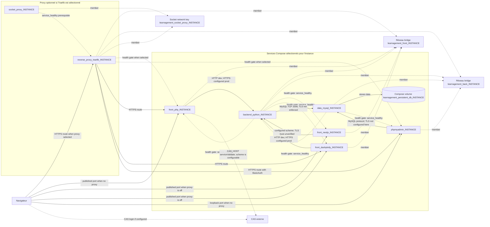

# Learnagement architecture

This diagram describes the Docker Compose configuration generated for one instance. It is a static view: it does not prove that services start or communicate at runtime. No Kubernetes manifest is present on this branch.

## Docker Compose topology

<!-- mermaid-checked: no \n, no em-dash/en-dash, no {} in labels, subgraphs are id["label"], arrows are -->|"label"|, all subgraphs closed by end, ids unique -->

MySQL uses TCP 3306 only on the Back network; Compose does not publish that port on the host. For health dependencies, arrows point from the required healthy service to the service it gates. The socket-proxy network and MySQL volume use Compose keys; Docker applies the project scope where no explicit network or volume name is set.