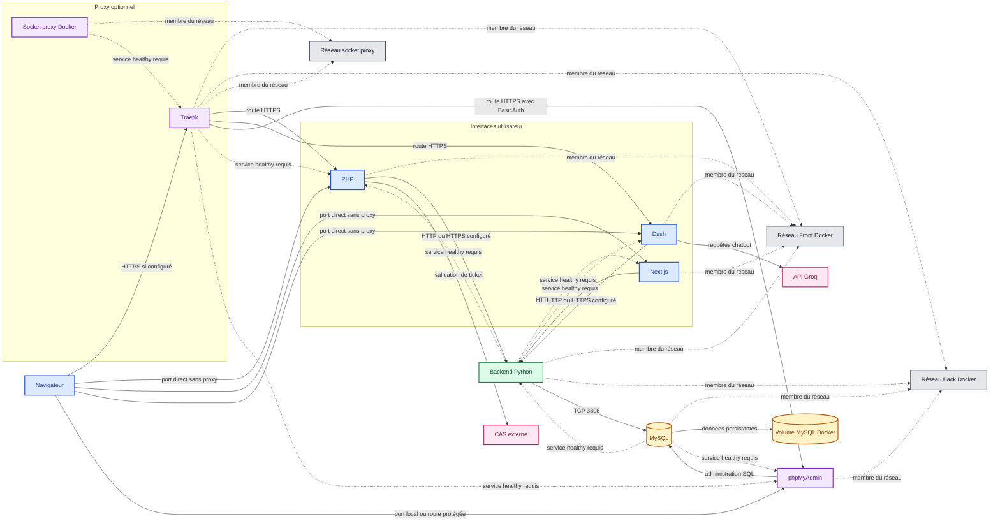

# Learnagement architecture

> Objectif : présenter les services Learnagement, leurs flux et les limites entre la configuration déclarée et le runtime.

Cette vue résume la topologie Learnagement telle qu'elle est préparée dans le dépôt. Elle décrit les interfaces PHP, Next.js et Dash, le Backend Python, MySQL, les réseaux Front/Back, phpMyAdmin et les intégrations externes confirmées. Traefik, le socket proxy et Groq sont représentés seulement selon leur usage réel ou leur caractère optionnel.

Le diagramme est une description statique de Docker Compose et ne prouve ni un démarrage runtime, ni les communications réelles. Le socle Kubernetes présent dans le dépôt est préliminaire et n'a pas été appliqué à un cluster.

## Docker Compose topology

<!-- mermaid-checked: no \n, no em-dash/en-dash, no {} in labels, subgraphs are id["label"], arrows are -->|"label"|, all subgraphs closed by end, ids unique -->

**Légende :** bleu = interfaces; vert = Backend; ambre = MySQL et persistance; gris = réseaux; violet = composants optionnels; rose = intégrations externes. Les traits pleins représentent les appels et les données; les pointillés représentent l'appartenance réseau ou une dépendance de santé Compose.

Le Backend est connecté aux deux réseaux; MySQL et phpMyAdmin sont sur Back. Le port MySQL n'est pas publié sur l'hôte. Groq est appelé directement par le chatbot Dash; aucun service IA autonome ni Ollama n'est représenté comme composant Learnagement confirmé.