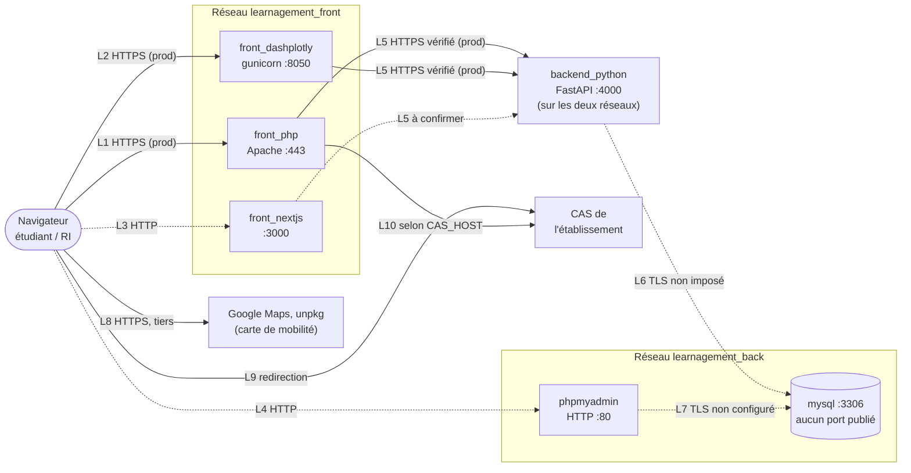

# Mesures de sécurité

IAG generated (claude Sonnet 5.5)

> Dernière vérification contre le code : branche `dev`, commit `a3b29588` (18/10/2026).
> Convention : ✅ garanti par le dépôt · ⚠️ dépend du déploiement (non vérifiable dans le dépôt) · ❌ non assuré par le dépôt.

## Authentification

- Connexion via le **CAS de l'établissement** (comptes locaux possibles, mots de passe hachés en **bcrypt**).
- Jeton **JWT signé (HS256)** à durée de vie limitée (`SESSION_TIMEOUT`, 900 s par défaut).
- La **clé de signature des jetons** (`JWT_SIGNING_KEY`) et le **jeton de service CAS** (`CAS_SERVICE_TOKEN`) sont deux secrets distincts, générés à l'installation. Le jeton de service est comparé en **temps constant**.
- Un compte local **inactif et sans mot de passe** est refusé.
- Les comptes CAS ne sont créés que si l'utilisateur appartient à un **groupe autorisé**.

## Contrôle d'accès

- Chaque requête SQL déclare les **rôles autorisés**. Un contrôle centralisé, **refusant par défaut** (HTTP 403), s'applique avant toute exécution.
- Les fonctions d'administration (lancement de l'algorithme, quotas, exports, remise à zéro, statuts) sont réservées au rôle **`relations_internationales`**.
- Un étudiant ne peut consulter ni modifier que **ses propres vœux** et **son propre statut d'affectation** : la règle `owner` vérifie à la fois le **rôle** et l'**identifiant** de l'utilisateur connecté.
- Les vœux ne sont plus modifiables **après soumission**. L'ajout de vœux est bloqué tant que la **campagne n'est pas ouverte**.
- Les écritures qui touchent plusieurs lignes de la mobilité (affectations, quotas, places, déplacement et suppression de vœux) s'exécutent dans **une seule transaction** : tout est enregistré ou rien.

## Protection des données et du code

- **Requêtes SQL paramétrées** : les valeurs saisies par l'utilisateur ne sont jamais concaténées dans le SQL. Les seules interpolations restantes portent sur des entiers déjà validés ou sur des noms de colonnes issus du rôle en base.
- **Chiffrement des échanges** : TLS en production sur les liens identifiés dans la section « Architecture réseau », qui précise aussi les liens **non chiffrés ou non vérifiés**. Les secrets sont dans des variables d'environnement.
- **Minimisation** : seules les données listées dans les mentions sont traitées. Aucune donnée sensible au sens de l'**article 9**.
- **Tests automatisés** du moteur de contrôle d'accès, de l'authentification CAS et des transactions. Ils sont lancés au démarrage du conteneur backend, mais **un échec n'interrompt pas le démarrage**, y compris en production.

## Architecture réseau des conteneurs

### Principe

Chaque instance est déployée avec `docker compose` et utilise **deux réseaux Docker** de type `bridge`, propres à l'instance :

| Réseau | Conteneurs rattachés | Rôle |
|---|---|---|
| `learnagement_front_<instance>` | `backend_python`, `front_php`, `front_nextjs`, `front_dashplotly` | Accès des interfaces au backend |
| `learnagement_back_<instance>` | `backend_python`, `mysql`, `phpmyadmin` | Accès aux données |

- ✅ Le **backend est le seul conteneur rattaché aux deux réseaux** : c'est le point de passage obligé entre les interfaces et les données.
- ✅ Les interfaces (PHP, NextJS, Dash) **ne partagent aucun réseau avec MySQL** : elles ne peuvent pas l'atteindre directement.
- ✅ **MySQL ne publie aucun port** sur l'hôte et n'est joignable que depuis le réseau `back`.
- ✅ Les certificats et clés sont montés en **lecture seule** dans les conteneurs.

### Schéma

Trait plein : chiffrement en production assuré par le dépôt. Trait pointillé : chiffrement non assuré par le dépôt.

### Flux et chiffrement

| # | Flux | Production | Développement | État dans le dépôt |
|---|---|---|---|---|
| L1 | Navigateur → front PHP (point d'entrée) | HTTPS, port 443, Apache `mod_ssl`, certificat « externe » | HTTP, port 40080 | ✅ activé par `ENV=prod`. ❌ Pas de redirection HTTP→HTTPS, ni HSTS, ni CSP configurés. |
| L2 | Navigateur → Dash (APC) | HTTPS, gunicorn avec le certificat « externe » | HTTP | ✅ |
| L3 | Navigateur → NextJS | Aucun TLS configuré | HTTP | ❌ Le conteneur lance `npm run dev` quelle que soit l'instance, port 3000 publié. |
| L4 | Navigateur → phpMyAdmin | HTTP uniquement | HTTP | ❌ Port 8080 publié (prod), authentification MySQL transmise sur ce lien. |
| L5 | Interfaces → backend | HTTPS, certificat « interne » **vérifié** par PHP (`CURLOPT_CAINFO`) et Dash (`verify=`) | HTTP | ✅ pour PHP et Dash. ⚠️ NextJS : aucune autorité de certification n'est configurée côté Node, à confirmer. |
| L5b | Backend (uvicorn) | HTTPS avec le certificat « interne » | HTTP | ✅ activé par `ENV=prod`. Le healthcheck utilise `curl -k` (sans conséquence, c'est un test local). |
| L6 | Backend → MySQL | Pilote `mysql-connector`, aucun paramètre TLS dans la configuration | Idem | ❌ Chiffrement ni imposé ni vérifié (voir ci-dessous). |
| L7 | phpMyAdmin → MySQL | Aucun paramètre TLS | Idem | ❌ |
| L8 | Navigateur → Google Maps / unpkg | HTTPS, directement depuis le navigateur | Idem | ✅ côté transport, mais **des tiers reçoivent l'adresse IP de l'utilisateur** (voir les mentions légales). |
| L9 | Navigateur → CAS | Redirection vers le CAS | Idem | ⚠️ dépend de l'URL du CAS. |
| L10 | Front PHP → CAS (validation du ticket) | `CAS_HOST/serviceValidate` | Idem ou mode mock | ⚠️ HTTPS seulement si `CAS_HOST` commence par `https://`. |

**Chiffrement vers MySQL (L6, L7).** MySQL 8.4 sait chiffrer les connexions avec des certificats auto-générés au démarrage, mais le dépôt n'impose rien : pas de `require_secure_transport`, pas de paramètre SSL dans le moteur SQLAlchemy, et le répertoire de configuration monté (`docker/mysql/conf.d`) n'existe pas dans le dépôt. Le trafic reste à l'intérieur du réseau Docker `back` (privé à l'hôte), ce qui limite l'exposition, mais le chiffrement n'est pas démontrable. L'authentification `mysql_native_password` est activée par la commande de lancement.

**Mode développement.** Tous les liens internes sont en HTTP clair. Le script d'installation avertit si une instance de la branche principale tourne sans `ENV=prod`. Une instance de développement ne doit jamais contenir de données réelles.

### Ports publiés sur l'hôte

| Service | Production | Développement |
|---|---|---|
| front PHP (point d'entrée) | 443 | 40080 |
| backend | 4000 | 44000 |
| Dash | 8050 | 48050 |
| NextJS | 3000 | 43000 |
| phpMyAdmin | 8080 | 48080 |
| MySQL | **aucun** | **aucun** |

❌ Les ports sont publiés **sans adresse d'écoute** (`4000:4000`, pas `127.0.0.1:4000:4000`), donc sur toutes les interfaces de l'hôte. Le fichier `__env_skeleton.env` indique qu'en production le backend et l'administration ne devraient être accessibles que depuis l'hôte : cela n'est pas mis en œuvre dans `docker-compose.yml.skeleton`. L'exposition réelle dépend du **pare-feu de l'hôte** (⚠️).

### Certificats

| Répertoire (hôte) | Monté dans | Utilisé par | Rôle |
|---|---|---|---|
| `SSL_EXTERNAL_DIR` | `/etc/ssl/learnagement-external/` | front PHP, Dash, NextJS | Certificat présenté aux navigateurs (Let's Encrypt en production, `mkcert` en développement, cf. `Doc/prod.md`) |
| `SSL_INTERNAL_DIR` | `/etc/ssl/learnagement-internal/` | backend, et tous les clients du backend | Certificat du backend, utilisé aussi comme autorité par PHP et Dash |

Le certificat interne doit inclure, dans ses noms alternatifs (SAN), le nom du conteneur backend (`learnagement_backend_python_<instance>`), sinon la vérification côté PHP et Dash échoue. La commande `openssl` de `Doc/prod.md` ne le fait pas : à compléter.

### Secrets

- ✅ Mots de passe MySQL, `JWT_SIGNING_KEY`, `CAS_SERVICE_TOKEN` et secret NextAuth sont **générés ou saisis à l'installation**, et stockés dans le fichier `.env` de l'hôte.
- ❌ Ils sont transmis aux conteneurs par variables d'environnement (lisibles avec `docker inspect`), pas par Docker secrets.
- ⚠️ Droits d'accès au fichier `.env` et aux clés privées sur l'hôte.

## Points non garantis par le dépôt

- [ ] **Exposition des ports** : restreindre le backend et phpMyAdmin à `127.0.0.1` ou au pare-feu, ou ne pas déployer phpMyAdmin en production.
- [ ] **TLS vers MySQL** : imposer `require_secure_transport=ON` et configurer le client en vérification de certificat, puis contrôler avec `SHOW SESSION STATUS LIKE 'Ssl_cipher'` depuis une session applicative.
- [ ] **NextJS en production** : servir un build (`next build` / `next start`) derrière TLS, ou ne pas le déployer.
- [ ] **Mode mock CAS** : `CAS_MOCK_ENABLED` doit rester à `false`. Aucune garde dans le code n'empêche son activation en production (un ticket `ST-MOCK-…` est alors accepté).
- [ ] **En-têtes HTTP** : HSTS, CSP, redirection HTTP→HTTPS absents de la configuration Apache.
- [ ] **Scripts tiers** : les extensions de cartographie (`leaflet.markercluster`) sont chargées depuis `unpkg.com` sans empreinte d'intégrité ; la clé Google Maps est visible dans la page et doit être restreinte par référent dans la console Google.
- [ ] **Journalisation** : le backend écrit chaque requête SQL **avec ses paramètres** dans la sortie standard (niveau INFO). Ces journaux contiennent donc des données personnelles ; la durée de conservation des journaux Docker n'est pas bornée (aucune option de rotation dans le compose).
- [ ] **Anti brute-force** : aucune limitation de tentatives de connexion sur `/token` et `/token-cas`.
- [ ] **Concurrence** : les contrôles « moins de 5 vœux » et le déplacement de vœux ne verrouillent pas les lignes ; deux requêtes simultanées d'un même étudiant peuvent produire un état incohérent.

## À confirmer côté infrastructure

- [ ] Localisation et hébergeur
- [ ] Sauvegardes et leur durée (aucune sauvegarde n'est définie dans le dépôt)
- [ ] Chiffrement au repos (volume MySQL, sauvegardes)
- [ ] Politique de journalisation
- [ ] Procédure d'effacement en fin de conservation (aucune purge automatisée dans le dépôt)
- [ ] Pare-feu de l'hôte et accès à l'administration (SSH, phpMyAdmin)
- [ ] Gestion et renouvellement des certificats (externe et interne)
