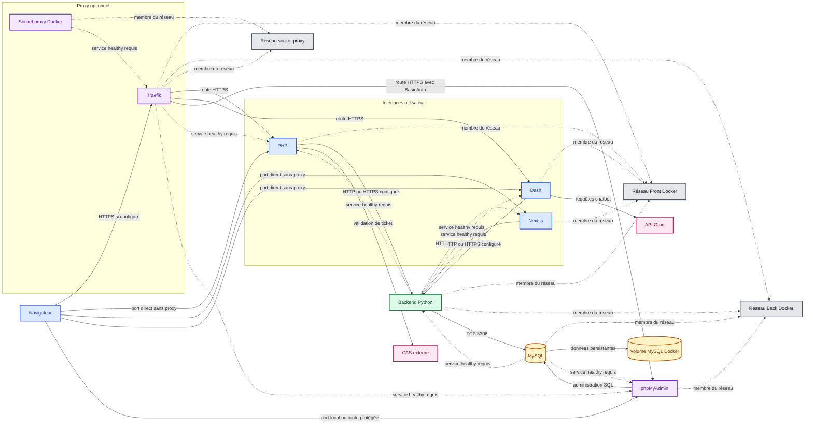

# learnagement
Learnagement (Learning management) est un outil d'intégration de données de l'enseignement.
Il a pour but fonctionnel de faire le pont entre étudiants, enseignants et administratifs. 
Il est principalement développé par les étudiants de l'USMB, ceux de la filière IDU de Polytech Annecy dans le cadre d'un apprentissage par projet et ceux de Licence de l'UFR SCEM dans le cadre de projets. 

L'App Web s'organise autour de différents objectifs enrichis par les axes de développement choisi par les étudiants, enseignants et services administratifs : la gestion du planning prévisionnel des enseignants, la cohérence entre le MCCC, le prévisionnel et la planification réelle, la gestion des absences des étudiants...

## Architecture

Cette vue résume la topologie Docker Compose : PHP, Next.js, Dash, Backend, MySQL et phpMyAdmin, les réseaux Front/Back et les flux confirmés. Elle distingue les composants optionnels et les services externes; elle ne constitue pas une preuve de fonctionnement runtime. [ARCHITECTURE.md](ARCHITECTURE.md) est la référence complète.



**Légende :** bleu = interfaces; vert = Backend; ambre = MySQL et persistance; gris = réseaux; violet = composants optionnels; rose = intégrations externes. Les traits pleins représentent les appels et les données; les pointillés représentent l'appartenance réseau ou une dépendance de santé Compose.

Le Backend est connecté aux deux réseaux; MySQL et phpMyAdmin sont sur Back. Le port MySQL n'est pas publié sur l'hôte. Groq est appelé directement par le chatbot Dash; aucun service IA autonome ni Ollama n'est représenté comme composant Learnagement confirmé.

Pour les ressources Kubernetes préliminaires et leurs limites, consulter [la documentation de la base](kubernetes/base/README.md) et [la checklist de déploiement](docs/kubernetes-deployment-checklist.md). Les manifests n'ont pas été appliqués à un cluster.

## Prérequis
OS X, Unix or Windows,
Docker desktop,
Python 3.

## Installation et lancement

### Dev Mode (Bootstrap)

Création de l'environnement, installation ou mise à jour des requirements, lancement de l'app
```bash
python3 bootstrap.py
```
L'environnement sera créé dans /.venv

### Dev Mode (a la mano)

Initialisation de l'environnement à ne faire qu'une seule fois
```bash
python3 -m venv venv
source ./venv/bin/activate
pip install -r requirements.txt
```


L'app se lance avec docker (pensez à lancer docker-desktop):
```bash
source ./venv/bin/activate
python Learnagement.py start
```

To configure your instance, edit specific ".env_XXX.env" files and restarts the app with:
```bash
python Learnagement.py start --env XXX
```

For any help
```bash
python Learnagement.py --help
```

### Production Mode

Generate self certificate:
```bash
python Learnagement_Security.py 
```

Generate environment
```bash
python bootstrap.py generate-env --env prod
```

Edit the .env file to configure your instance.

Run with prod environnement (secure):
```bash
source .venv/bin/activate
python Learnagement.py start --env prod
```
Note, containers will rebuild.


## Utilisation

Lors du 1e lancement il vous sera demandé si vous souhaitez charger des données. 
Si vous avez chargé le jeu de données libres "small", vous trouverez via PhPMyAdmin un ensemble d'utilisateurs de test dont :
- un enseignant : AMELIE.CODRON@truc.com / toto
- un étudiant : LAURENT.BONNIFAIT@machin.com / toto
- un administratif : pierre.tartampion@truc.com / toto

Pour tous les utilisateurs - administratif, enseignant ou étudiant - qui ont un mot de passe, ce dernier est ```toto```.

Si vous n'avez pas chargé de données de test, vous devrez saisir ou importer vos propres données

**Multi-instances** : 

Si vous souhaitez lancer plusieurs instances de Learnagement sur la même machine :
- Re-cloner le dépot GIT
- Re-faire la procédure de lancement initiale en changeant le nom et le numéro d'instance

Actuellement 4 instances en parallèle sont possibles.

## Arrêt de l'app

L'app s'arrête, sans perte de donnée, via la commande :  
```bash
python Learnagement.py -stop
```

## Stop or Clean up from scratch the app


To destroy, remove all data to restart from scratch:  
```bash
python Learnagement.py stop
python Learnagement.py start --from_scratch
```

## Major upgrade

- step 1: back-up your DB
```bash 
python Learnagement.py backupdb
```
- step 3: stop the current instance
```bash
python Learnagement.py stop
```
- step 4: deactivate your python environment
- step 4: move out of your Learnagement directory, get a new clone of Learnagement git, create, activate a new python environment and install requirements 
- step 5: move into the new repository and switch to the required branch
- step 6: create "./db/data/" directory and copy your backed-up data into
```bash 
mkdir ./db/data/
cp /[INITIAL PATH TO LEARNAGEMENT]/db/backup/VX.X.X__data_XXX[CURENT DATE].sql ./db/data/
```
- step 7: start the new instance (it will start like 1st time, so given the same port to the old instance to keep the service continuity)
```bash
python Learnagement.py start
```

[Doc](Doc/doc.md) - [ToDo Lists](./ToDo/ToDo.md) - [CRediT](./CREDITS.md) - [Licence](./LICENSE)
